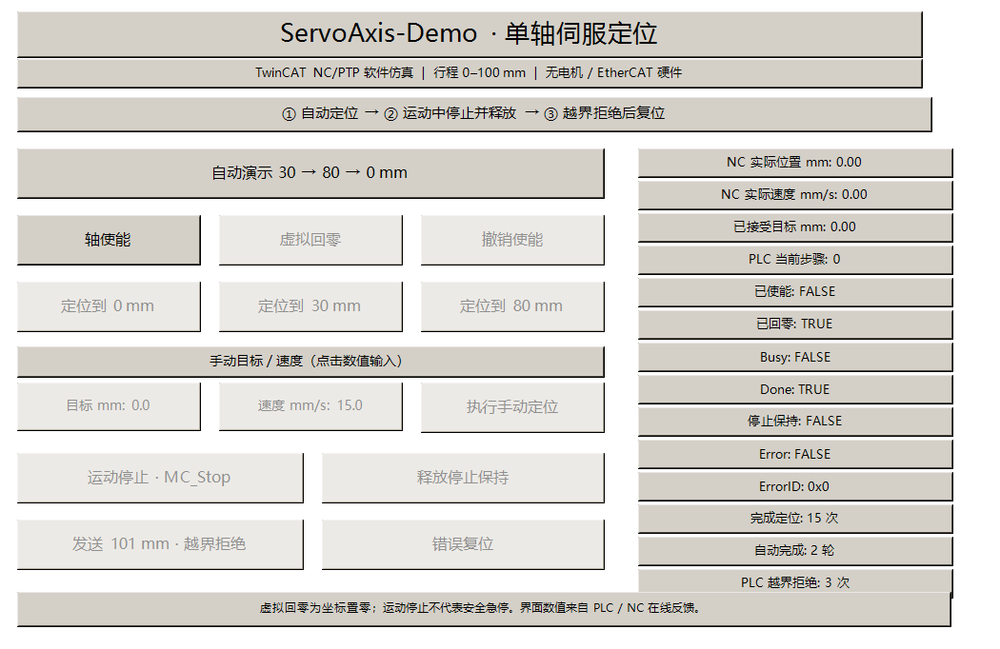
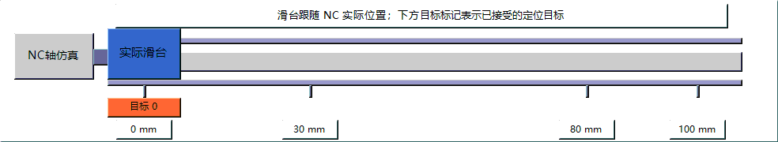

# Servo Motion Lab · 伺服运动控制作品集

面向伺服与运动控制岗位的长期工程仓库，使用可复现的工程、代码和测试记录说明实际能力。
首个示例是 **ServoAxis-Demo**：Beckhoff TwinCAT 3.1 Build 4026 的真实 NC/PTP 单轴仿真。

**当前状态：真实 NC/PTP 单轴仿真已运行，原生动画候选有 16 项界面检查及自定义速度实测记录。**
在原生 Visualization 中直接点击使能、回零、自动定位、运动停止、越界拒绝和复位；
位置、速度、Busy/Done/Error 来自 PLC/NC 在线反馈。支持键盘输入目标位置与速度。
动画和自定义速度的10月13日记录见 [动画候选实测](evidence/2026-10-13-animated-demo/README.md)；
本候选的完整核心回归、新建构建与冷启动入口仍待补验。
此前记录见 [内置面板验收](evidence/2026-10-13-native-visualization/README.md)、
[最初的单轴验收](evidence/2026-10-13-single-axis/README.md) 和
[操作说明](examples/ServoAxis-Demo/README.md)。原生 NC 故障注入和整机重启仍待验。





动图为一轮实际运动的原始捕获帧循环回放，没有插帧或生成位置；采样间隔不代表当前画面帧率。
面向PLC/伺服岗位的 [作品说明卡](docs/INTERVIEW_CARD.md) 与 [10月22—24日展示计划](docs/SHOWCASE_PLAN.md)。

## 第一阶段：2026 年 10 月 22—24 日线下展示版

- 使用真实 NC/PTP 仿真轴和 AXIS_REF，不自行累加位置变量代替轴运动。
- 使用 Tc2_MC2 / PLCopen 的 MC_Power、MC_Home、MC_MoveAbsolute、MC_Stop、MC_Reset。
- 实现手动/自动控制、虚拟回零、0 → 30 → 80 → 0 mm 顺序定位，以及 0～100 mm 限位。
- 在线观察真实轴的位置、速度、步骤与功能块反馈；保留编译日志及实际运行测试记录。
- 验收至少三次定位、运动中停止、越界命令拒绝；用中文说明操作步骤与面试讨论点。

完整需求：[ServoAxis-Demo](docs/REQUIREMENTS.md)。验收规则：[验证与证据](docs/VALIDATION.md)。

## 仓库组织

```text
examples/ServoAxis-Demo/    单轴 ST、原生 TcVIS 面板与仿真操作说明
docs/                      需求、架构、验证、路线图与展示说明
evidence/                  经脱敏的环境/构建/实际运行证据
tools/                     原生工程生成、专用 Runtime、控制命令与验收工具
third_party/               复用面板交互配置的来源与许可证
```

仓库：[biaobiao2233/servo-motion-lab](https://github.com/biaobiao2233/servo-motion-lab)。
当前任务与里程碑以 GitHub Issues / Milestones 为准；长期路线见 [ROADMAP](docs/ROADMAP.md)。

## 仿真与硬件的界限

当前没有真实伺服电机、驱动器或 EtherCAT 设备。NC 仿真可以验证 PLCopen 调用与
应用状态机，不能用来声称已验证实际 EtherCAT 通信、电机整定、机械精度或安全急停。
MC_Stop 是运动控制停止；本示例不构成硬件安全功能验证。

后续引入真实设备时，硬件身份、接线、限位、调试记录与验收将形成独立任务。

## 长期维护

采用 [Project Continuity / Project Workbench](https://github.com/biaobiao2233/project-continuity)：
从当前 Issue/PR 恢复工作，隔离分支和运行资源；区分代码候选、已构建与实际运行通过。
贡献和 Agent 工作边界见 [AGENTS.md](AGENTS.md)。

官方基础资料：[NC 仿真轴](https://infosys.beckhoff.com/content/1033/tf50x0_tc3_nc_ptp/10541544203.html)、
[PLCopen 轴控制](https://infosys.beckhoff.com/content/1033/tf50x0_tc3_nc_ptp/10541540363.html)、
[用户态 Runtime 多实例](https://infosys.beckhoff.com/content/1033/tc170x_tc3_usermode_runtime/11666126859.html)。
