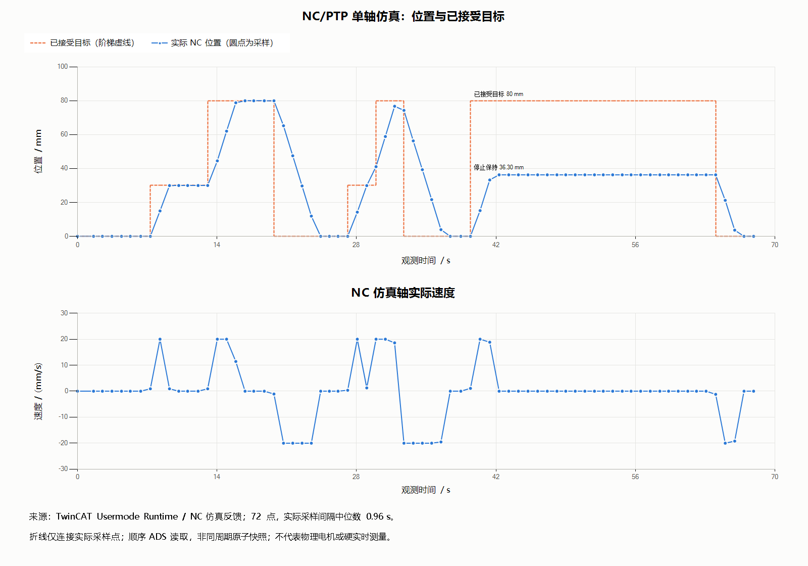

# 2026-10-13 单轴 NC 仿真验收

**最低功能验收 PASS**。观测时间 2026-10-13 04:15:32～04:16:42（UTC+08）。
TwinCAT 3.1.4026.27，NC/PTP 用户态组件 3.1.5049，Tc2_MC2 3.3.75.0，
目标平台 TwinCAT OS (x64)。没有物理电机或 EtherCAT 设备。

| 检查 | 实际结果 |
|---|---|
| 使能、MC_Direct 回零 | Status/Homed/Done 成立，坐标 0 mm |
| 手动 30、80、0 mm | 三次都有 MoveBusy 和实际速度，完成反馈成立，最终位置分别 30、80、0 |
| 自动 30→80→0 mm | 观察三段目标和 Busy，完成计数增加 3，最终 0 mm |
| 运动中停止 | 向 80 mm 运动时停止，停在 36.2999993 mm，速度 0 |
| 停止保持/释放 | 新定位被停止锁阻止；显式释放后 Busy 与应用锁解除 |
| −1、101 mm 请求 | 各拒绝一次，应用错误 A001，未发生定位或位置变化 |
| 拒绝后的复位 | MC_Reset Done 成立，应用错误清除，可继续定位 |
| 结束 | 回到 0 mm，撤销使能，Error=false |

定位容差预设 0.02 mm，静止速度阈值 0.01 mm/s。14 项检查及具体反馈见
[acceptance.json](acceptance.json)。7 份 ST 与已运行原生工程的声明/实现文本逐份匹配；
报告包含源文件、已运行 PLC 程序、启动配置与 CSV 的 SHA-256。
构建：[build.json](build.json)、[原生构建输出](native-build.log)。
无关输出窗格读取的 E_FAIL 如实保留；实际生成窗格为 0 errors / 0 warnings。
配置 API 返回未作为运行 PASS，最终以实际 PLC/NC 状态与运动反馈判定。

[monitor.csv](monitor.csv) 含 72 个真实观测点。工具请求间隔 50 ms，但每点顺序读取
多个 ADS 变量，实际间隔中位数约 **0.96 s**，以时间戳为准。
折线只连接观测点，没有插值生成额外测试数据；短暂经过的精确终点可能处于两点之间。
自动完成判据包含功能块反馈、真实完成计数和最终位置。

未验：原生 NC 故障注入、复位失败/超时、整机 Windows 重启；无真实 EtherCAT、
电流/扭矩/机械负载/整定或安全急停验证。PASS 只覆盖上表 NC 仿真检查。
原始本机日志、许可证、SDK 和完整配置不公开。

追加 [专用 Runtime 重启复演](runtime-restart.json)：停止并重启自有实例后，复用已保存的
Boot 和许可，自动三次定位再次完成；同一 PLC 程序哈希，结束在 0 mm 并撤销使能。
这不包含整机 Windows 重启。
